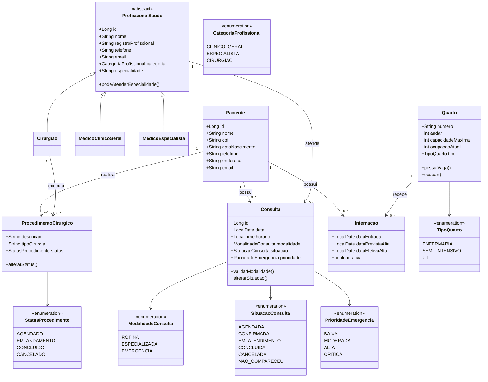

# Diagrama de Classes — Sprint 2

O modelo da Sprint 2 mantém as seis classes principais da Sprint 1 e adiciona a especialização dos profissionais, as modalidades de atendimento, as situações controladas por enum e os procedimentos cirúrgicos.

## Regras representadas

- Consultas especializadas exigem profissional com especialidade compatível.
- Emergências exigem prioridade `BAIXA`, `MODERADA`, `ALTA` ou `CRITICA`.
- O mesmo profissional não pode ter dois atendimentos no mesmo horário.
- Uma consulta concluída não retorna para agendada e uma cancelada não é concluída.
- Internações somente ocupam quartos com vaga.
- Procedimentos cirúrgicos só podem ser concluídos depois de entrarem em andamento.
